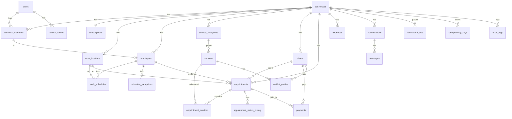

# ER diagram

Constraints beyond FKs: see `database/README.md` (exclusion constraint, checks). All PKs are UUID; deletes cascade from `businesses` (tenant erase), appointments keep `Restrict` on employee/location/service so history cannot be orphaned.
